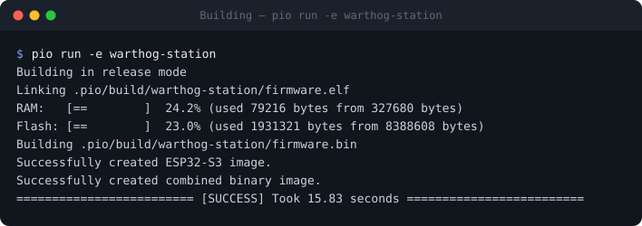
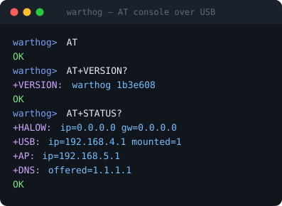
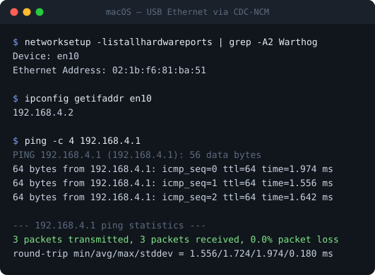
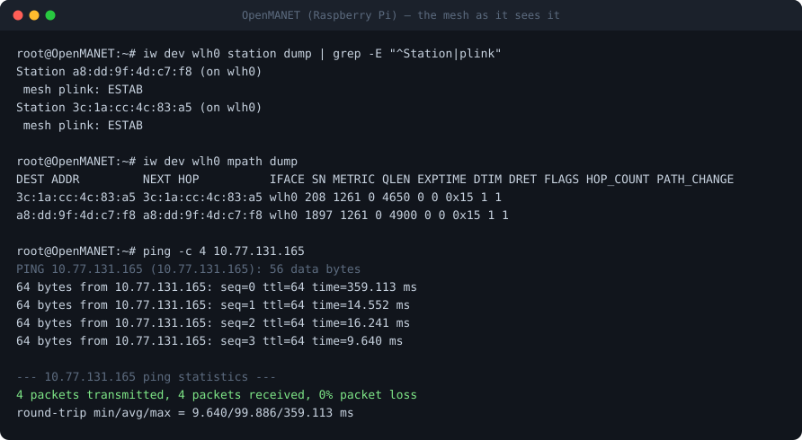

# Warthog

```
           .                   .
           .        :      ----::
           .        :...........:-:.-..:-
           .            :.--.:-::
           .            :..-....:
           .              ...:  :::
           .            .:...:-..:::.-------:--:.--::-.
           .           -...-.:.:...             ::..:......::..
    .:..:::-         :..-.-...-...:.         :. .-:...:::::::::-::...::.
    .:.::::--..:................:.:          :..............:.:-------:: .
     .-::::-..:-........::::..:----.:     ::...----:....-..::--:.......-::
        -----:---------:..:..:.......--:------.......::..:.---.........:.:
        :.....:---:----..:..:..::..................-...-:-...:---:-:.....--
       ...---.::---::.---:..-::...---------------....--.:..-.::-----.-...--.
        .  -::.......::--:.-..:-:...:..........:...-:.-..--:-.......:.--:.-
          ::-.........-::...-:......-..........-:...::...::-.........-:.
          :.-.........:.:      :-------------------.     :.:............
          :..:........:.:                                ..:.........-.:
           ..:-.....-:::                                  :.:-.....-:.:
             :::.:.:.-                                      ::..:.:.-
```

> **Warthog** — open-source firmware turning an ESP32-S3 + Wi-Fi HaLow module into a long-range USB Ethernet and 2.4 GHz Wi-Fi AP gateway you can hack.

A host plugged in over USB gets an Ethernet adapter; phones join a 2.4 GHz AP.
Both are routed out a sub-GHz 802.11ah HaLow link — to an access point, or as a
peer in an 802.11s mesh. A USB console takes AT commands for runtime
configuration.

For a plain HaLow USB adapter, a commercial dongle (Heltec HT-HD01 V2, Alfa
AHUS-1, Vantron MM8108) is simpler. Warthog is firmware you own and modify.

## Features

- **USB CDC-NCM** Ethernet adapter, in-box on macOS, Linux, Windows 10+ and iOS/iPadOS (CDC-ECM build: `warthog-us-ecm`)
- **2.4 GHz Wi-Fi AP** for clients that are not wired
- **HaLow uplink** on a Morse Micro MM6108 (Quectel FGH100M-H): station mode to an AP, or an **802.11s mesh** peer
- **Mesh security:** SAE authentication and AMPE per-link keys
- **[OpenMANET](#openmanet) / OpenWrt interop**, including membership of a batman-adv `bat0` (`AT+MESHBATMAN=1`)
- **NAT** between every surface by default; **L2 bridge mode** (`AT+MESHBRIDGE=1`, experimental)
- **802.11s forwarding** (`AT+MESHFWD=1`, experimental)
- **USB CDC-ACM console** with ESP-IDF logs and an **AT command** interface; settings persist in NVS
- Per-region builds (US / EU / JP / KR / AU), board config and country code fixed at compile time
- ESP-IDF 5.5, TinyUSB, `morsemicro/halow`

Not supported: per-transmitter group keys in the chip (except on
`warthog-mesh-sae-meshvif`), multicast across the mesh on a leaf, batman-adv's
distributed ARP table, multicast optimisation, gateway mode and bridge loop
avoidance, Windows RNDIS, a web UI.

## Documentation

The [wiki](wiki/Home.md) has the quick start, flashing, each operating mode, the
[AT command reference](wiki/AT-Command-Reference.md) and
[troubleshooting](wiki/Troubleshooting.md). Technical notes are in [`docs/`](docs/).

## Hardware

- [Seeed Studio XIAO ESP32-S3](https://www.seeedstudio.com/XIAO-ESP32S3-p-5627.html)
- [Seeed Studio Wi-Fi HaLow module for XIAO](https://www.seeedstudio.com/Wi-Fi-HaLow-Module-for-Seeed-Studio-XIAO-p-6262.html) (Quectel FGH100M-H, MM6108)
- 900 MHz antenna, I-PEX → SMA pigtail

About $30 in parts.

> ⚙️ **Required mod:** the add-on feeds the PA supply (`VDD_FEM`) straight from
> USB VBUS with 20 µF of bulk capacitance, and the radio's inrush resets the
> ESP32-S3 (`POWERON`). Add a **470–1000 µF / ≥ 16 V** low-ESR capacitor across
> the XIAO's 5V and GND pads. See [`docs/power-notes.md`](docs/power-notes.md).

## Quick start

**1. Build**

```bash
pio run -e warthog-us
```



**2. Flash.** The console and USB network run on USB-OTG, so esptool cannot
reset the board into download mode. **Hold BOOT, tap RESET, release BOOT**, then:

```bash
pio run -e warthog-us -t upload
```

Tap **RESET** when it finishes. Without a toolchain, use the
[web flasher](https://thebentern.github.io/warthog/) (Chrome, Edge or Opera). It
writes the factory image, which erases stored settings; its Configure tab sends
the same AT commands.

**3. Console.** `/dev/cu.usbmodem*` (macOS) or `/dev/ttyACM*` (Linux), 115200 8-N-1.
`AT+STATUS?` reports the HaLow uplink, the USB network, the Wi-Fi AP and the DNS
offered to clients.



**4. Network.** The same cable presents a USB Ethernet adapter; the host takes a
DHCP lease from the board.



These screenshots are regenerated against an attached board by `scripts/regen-screenshots.sh`.

## Builds

| Env | Purpose |
|---|---|
| `warthog-us`, `-eu`, `-jp`, `-kr`, `-au` | Region builds. Station uplink by default; `AT+MESHEN=1` runs the mesh instead |
| `warthog-us-ecm` | CDC-ECM instead of CDC-NCM, for a host that binds ECM only |
| `warthog-mesh-smoke` | Mesh without SAE |
| `warthog-mesh-sae` | SAE/AMPE, keys in the chip |
| `warthog-mesh-sae-meshvif` | SAE/AMPE, keys in the chip, MESH chip interface — for OpenMANET |
| `warthog-mesh-sae-swccmp` | SAE/AMPE, host software CCMP (`AT+SWCCMP=1` or batman mode) |
| `warthog-mesh-sae-swccmp-on` | As `-swccmp`, with host CCMP on at boot |
| `warthog-mesh-sae-swccmp-meshvif` | SAE/AMPE, host CCMP, MESH chip interface — for OpenMANET in batman mode |
| `warthog-mesh-sae-nochipkey` | Host-CCMP receive probe; not a shipping build |

Region frequency ranges: US 902–928 MHz, EU 863–868 MHz, JP 916.5–927.5 MHz,
KR 917.5–923.5 MHz.

## Flashing

**Release bundles**, one per region plus `mesh-smoke` and `mesh-sae`, are on the
[releases page](../../releases):

| File | Purpose |
|------|---------|
| `warthog-vX.Y.Z-REGION.factory.bin` | Bootloader + partitions + app, written at `0x0`. **Erases stored settings** |
| `warthog-vX.Y.Z-REGION.bin` | App only, at `0x10000` |
| `warthog-vX.Y.Z-REGION.elf` | Symbols for `addr2line` |
| `warthog-vX.Y.Z-REGION-{bootloader,partitions}.bin` | For flashing piecewise |
| `flash.sh` | Flasher: finds the port, wraps `esptool` |
| `SHA256SUMS.txt` | Checksums for every `warthog-*` file |

```bash
./flash.sh warthog-v0.1.0-us.factory.bin   # in download mode: hold BOOT, tap RESET, release BOOT
```

Tap RESET when it finishes.

The factory image is blank over the NVS partition (`0x9000`), so the board comes
up on build defaults. To keep settings, write the bootloader, partitions and app
images at `0x0`, `0x8000` and `0x10000` instead.

**Reflashing a running board** needs no buttons: `AT+DLMODE` re-enumerates it as
the ROM port (`303a:0009`). Flash that and leave with a watchdog reset
([Flashing](wiki/Flashing.md#reflashing-a-running-board)):

```bash
python -m esptool --chip esp32s3 --port /dev/cu.usbmodemXXXX --baud 921600 \
  --before no-reset --after watchdog-reset write-flash \
  0x0 .pio/build/warthog-us/bootloader.bin \
  0x8000 .pio/build/warthog-us/partitions.bin \
  0x10000 .pio/build/warthog-us/firmware.bin
```

Writing `firmware.factory.bin` at `0x0` instead erases settings.

`pio device monitor -e warthog-us` opens the console.

## Configuration

### Build-time defaults

Override any of these through `PLATFORMIO_BUILD_FLAGS` (all but
`WARTHOG_MESH_PASSPHRASE` are set in `[warthog_base]` in `platformio.ini`). Values
stored in NVS take precedence.

| Macro | Default | Controls |
|---|---|---|
| `HALOW_SSID` / `HALOW_PASSPHRASE` | empty | HaLow AP credentials |
| `WARTHOG_AP_SSID` | `warthog` | Wi-Fi AP SSID |
| `WARTHOG_AP_PSK` | `warthog-default` | Wi-Fi AP WPA2 passphrase |
| `WARTHOG_USB_GW_IP` / `_NETMASK` | `192.168.4.1/24` | USB subnet (hosts from `.2`) |
| `WARTHOG_AP_GW_IP` / `_NETMASK` | `192.168.5.1/24` | Wi-Fi AP subnet |
| `WARTHOG_DOWNSTREAM_DNS` | `1.1.1.1` | DNS offered to USB and AP clients (DHCP option 6) |
| `WARTHOG_MESH_PASSPHRASE` | `warthog-mesh` | Default SAE passphrase |

```bash
PLATFORMIO_BUILD_FLAGS='-DHALOW_SSID=\"MyHaLowAP\" -DHALOW_PASSPHRASE=\"secret\"' pio run -e warthog-us
```

### AT commands

On the CDC-ACM console. Full list: [AT command reference](wiki/AT-Command-Reference.md).

```
AT+VERSION?                 firmware version
AT+STATUS?                  every interface's address and the offered DNS
AT+HALOW=MyAP,secret        HaLow credentials (AT+RESET to apply); AT+HALOW? shows the SSID
AT+WIFIAP=warthog,secret99,11
                            Wi-Fi AP SSID, PSK (8-63 chars), channel; AT+WIFIAP? reads back
AT+DNS=8.8.8.8              DNS offered to clients; AT+DNS? reads back
AT+MESHEN=1                 mesh uplink instead of station (AT+RESET to apply)
AT+MESHID=halowmesh         mesh ID; must match every peer
AT+MESHPASS=secret          SAE passphrase; AT+MESHPASS? reports only its length
AT+MESHCHAN=42,923000000,69,2,2
                            pin the S1G channel (region builds ship unpinned)
AT+MESHCFG?                 everything a peer must match
AT+RESET                    reboot
AT+ERASE                    erase all settings in the NVS namespace `warthog`
```

`AT+DNS=` rejects anything that is not a valid IPv4 address (`+ERR: not a valid
IPv4 address`). Settings live in NVS namespace `warthog`; `AT+ERASE` clears all
of them, returning DNS and credentials to the build defaults.

## Operating modes

```
        ┌──────── downstream ────────┐        ┌──── uplink ────┐

  laptop ──USB──▶ CDC-NCM ┐
                          ├─▶ NAPT ─▶ HaLow ─▶  AP  (station mode)
  phone  ──WiFi─▶ 2.4 AP  ┘                or  mesh (802.11s peers)
```

| Mode | Function | Enabled |
|---|---|---|
| **Host** | USB Ethernet adapter, `192.168.4.1/24` | always |
| **Client** | 2.4 GHz AP, `192.168.5.1/24` | always |
| **Station uplink** | Joins a HaLow access point | default |
| **Mesh uplink** | 802.11s peer, no infrastructure | `AT+MESHEN=1` |

Both downstream surfaces run at once. The uplinks are mutually exclusive.

### NAT (default) and bridge mode

By default each surface is its own subnet and Warthog NAPTs between them
(`main/nat.c`). Consequences:

- Broadcast and link-local discovery (mDNS/DNS-SD, SSDP, NetBIOS) does not cross.
- Multicast does not cross, except Meshtastic's `239.0.0.69:4403`, repeated by
  `main/mudp.c` between USB, AP and HaLow.
- ATAK/CoT multicast discovery (`239.2.3.1:6969`) does not work: every Warthog
  gives its host a `192.168.4.x` address, and CoT carries the sender's address in
  its payload. Point-to-point CoT to a routable address works.
- Inbound connections to a tethered host need explicit forwarding.
- IP fragments are reassembled before NAPT and re-fragmented for the outgoing
  MTU (`main/nat_frag.c`): IPv4 only, at most 10 fragments held at once, so a
  datagram of more than 10 is never delivered.

`AT+MESHBRIDGE=1` puts USB, the Wi-Fi AP and the mesh on one L2 segment, with
NAT and the multicast repeater off. Hosts keep their own MACs and take addresses
from the mesh's DHCP server, which is what CoT and mDNS discovery need.
See [Mesh Mode](wiki/Mesh-Mode.md#bridge-mode).

### Leaf (default) and relay

A Warthog is a mesh leaf by default: it does not forward frames between other
nodes, so it does not extend a mesh's reach.

- A unicast addressed to another mesh node is dropped (`AT+RXCHAN?` reason 93,
  or 94 without Mesh Control).
- A leaf neither relays a PREQ nor starts path discovery; its only PREQs are
  per-peer keepalives.
- The multicast repeater never re-sends a datagram out the interface it arrived on.
- Hosts behind another mesh node (a bridged OpenMANET node's LAN) are learned
  from Address Extension frames a peer carried (under SAE, a keyed peer). Replies go to that node in
  Address Extension mode 2: directly if it is a peer, else through the peer that
  carried it.
- First contact from a host behind a far node can fail on an idle mesh: a
  vanilla mac80211 relay with no path to that node drops the reply with a PERR. A
  Warthog relay holds the reply and runs discovery, giving up after 6.8 s.
- Broadcasts go as one replica per peer (or one standard group frame with
  `AT+MESHGRP=1`); a unicast to an unknown address goes to the first peer.

`AT+MESHFWD=1` makes it a relay: it forwards path selection and data for other
nodes and advertises the capability. See [Mesh Mode](wiki/Mesh-Mode.md#forwarding).

## Mesh mode (802.11s)

Every node is a peer: nothing to associate to, and a node that goes down takes
only its own links with it. `AT+MESHEN=1` enables the mesh on any build; mesh ID,
passphrase and channel are runtime settings. The mesh envs always run the mesh
and set default channel and mesh ID values (`AT+MESHCHAN=` and `AT+MESHID=`
override them). Whether a build speaks SAE/AMPE is a build-time choice.

- **Security (SAE builds):** SAE authentication (group 19; a peer's commit in
  group 20 or 21 is accepted) and AMPE key exchange — a pairwise key per link, a
  group key per node. One passphrase for every node: `AT+MESHPASS=`, default
  `warthog-mesh`.
- **Addressing:** a node asks for a DHCP lease on the mesh for 6 s after its
  first peer establishes, then takes `10.77.<mac[4]>.<mac[5]>/16` from its MAC
  (`3c:1a:cc:4c:83:a5` → `10.77.131.165`) and keeps asking beside it: at once when
  another peer establishes, otherwise after 30 s, doubling to 10 min. A lease
  replaces the static address; a lost lease puts it back. `AT+MESHDHCP=0` uses the
  static address only, and stops further asking without a reset.
- **Batman mode addressing:** the address comes up on the first batman route,
  with a 45 s DHCP wait, an ARP-probed `10.41.253.x/16` fallback beside which DHCP
  keeps asking, and a new lease when the old one's router leaves
  ([Batman Mode](wiki/Batman-Mode.md)).
- On `warthog-mesh-sae` the encrypted data plane is Warthog-to-Warthog only: the
  chip cannot open a peer's group frames. Host CCMP (`-swccmp` builds) or
  `warthog-mesh-sae-meshvif` (each peer's group key installed in the chip at its
  AID) can.

```
AT+MPMPEERS?                 peers, handshake state, AMPE key counters
AT+SAERX?                    SAE / peering state machine
AT+MESHSEC=0                 open data plane, for peers set to encryption='none'
AT+MPING=10.77.199.248,4     ping over the mesh
```

## OpenMANET

Warthog joins an [OpenMANET](https://github.com/OpenMANET/firmware) mesh as an 802.11s peer of its
Linux `mac80211` nodes: as a plain mesh point, or as a BATMAN_V member of the
node's `bat0`. Compatible with OpenMANET 1.8.0 (Raspberry Pi 4 with a Seeed HaLow
HAT, batman-adv 2025.4). Typical use: phones and EUDs on a Warthog's Wi-Fi AP or
USB, reaching the mesh — see [OpenMANET Gateway](wiki/OpenMANET-Gateway.md).



### Compatibility

Both sides must use the same security mode. An SAE/open mismatch never peers; a
non-SAE Warthog left at `AT+MESHSEC=1` peers with an open node but passes no data.

| OpenMANET node | Warthog build | Warthog settings |
|---|---|---|
| LuCI mesh wizard (SAE, mesh ID `openmanet`, passphrase `changeme123`, `wlh0` in `bat0`) | `warthog-mesh-sae-swccmp-meshvif` | `AT+MESHBATMAN=1` |
| SAE mesh without `bat0` | `warthog-mesh-sae-meshvif` | — |
| Open mesh (`encryption='none'`) | `warthog-mesh-smoke`, or a region build with `AT+MESHEN=1` | `AT+MESHSEC=0` |

- A fresh OpenMANET image runs no mesh: its HaLow radio is an SAE access point.
- The `-meshvif` builds are not in the release bundles; build them from source.
- `warthog-mesh-sae` peers with an OpenMANET node but cannot open its group
  frames, so the node never gets a path to it. Use it for Warthog-only meshes.
- Under SAE, batman mode needs host CCMP: `warthog-mesh-sae`, `-nochipkey` and
  `warthog-mesh-sae-meshvif` refuse `AT+MESHBATMAN=1`; open builds accept it. In
  plain mesh mode a Warthog has no IP path into `bat0`.
- A node's unicast above its RTS threshold (1000 bytes, OpenMANET's default)
  reaches a Warthog from every node only on the `-meshvif` builds. On other builds
  it arrives only from the peer the chip registered last, unless each node is set
  to CTS-to-self or RTS off
  ([details](wiki/OpenMANET-Interop.md#frames-over-about-1000-bytes-from-a-linux-node)).
- On a `-swccmp` build outside batman mode, arm host CCMP with `AT+SWCCMP=1` after
  each boot (`-swccmp-on` arms it at boot; batman mode arms it itself).
- On an SAE mesh, update every Warthog together (see [Security](#management-frame-protection-80211w)).

### Setup

**1. Read the node's configuration** (on the OpenMANET node):

```sh
ip addr show bat0                 # present: a wizard node, use batman mode
uci get wireless.radio1.channel   # radio1 is the HaLow radio
uci show wireless | grep -E 'radio1\.country|default_radio1\.(mesh_id|encryption)'
```

**2. Build and flash** the Warthog env from the table. Hold BOOT, tap RESET, release BOOT, then:

```bash
pio run -e warthog-mesh-sae-swccmp-meshvif -t upload
```

**3. Match the mesh** on the Warthog console, then reboot:

```
AT+MESHID=openmanet
AT+MESHPASS=changeme123            SAE builds; AT+MESHSEC=0 instead for an open node
AT+MESHCHAN=42,923000000,69,2,2    the node's channel: <chan>,<freq_hz>,<gclass>,<sclass>,<bw_mhz>
AT+MESHBATMAN=1                    wizard node only
AT+RESET
```

The mesh envs default to channel 42 at 2 MHz (OpenMANET's default) and mesh ID
`halowmesh`; region builds ship with no channel pinned, so set it there.

**4. Prepare the node.**

- *Wizard node:* leave it as configured; never take `wlh0` out of `bat0`. `bat0`
  must run `routing_algo` BATMAN_V (a hand-made `bat0` defaults to BATMAN_IV,
  which Warthog drops), and 802.11s forwarding should be off on every Linux node
  (mesh11sd `mesh_fwding '0'`).
- *Node without `bat0`:* `wlh0` stays in `br-lan`, which ignores an address put
  on `wlh0`. If the node serves DHCP on `br-lan`, a Warthog takes a lease from it.
  To reach Warthogs on their static addresses, give `br-lan` an address in their
  subnet:

  ```sh
  ip addr add 10.77.191.116/16 dev br-lan
  ```

  Or unbridge `wlh0`, address it, and let it back through the firewall (unbridging
  drops it out of the `lan` zone):

  ```sh
  ip link set wlh0 nomaster
  ip addr add 10.77.191.116/16 dev wlh0
  nft insert rule inet fw4 input iifname "wlh0" accept
  ```

  Make either permanent in `/etc/config/network` and `/etc/config/firewall`.
  Do not set `mesh_nolearn=1`.

**5. Verify.**

| Where | Command | Expect |
|---|---|---|
| Warthog | `AT+MPMPEERS?` | `estab=1` and a non-zero `plid` per node |
| Warthog, plain mesh | `AT+MPING=10.77.191.116,8` | replies from the node |
| Warthog, batman | `AT+MESHBATMAN?`, `AT+BATN?` | `running=1 reason=ok`; one line per node |
| Node | `iw dev wlh0 station dump` | `mesh plink: ESTAB` for the Warthog |
| Node | `iw dev wlh0 mpath dump` | the Warthog with `FLAGS 0x15` at hop count 1 |
| Node, batman | `batctl n` | the Warthog's mesh MAC |

**Addressing.** In plain mesh mode a Warthog takes a DHCP lease from a node that
keeps `wlh0` in `br-lan` and serves DHCP there: on its first peering, or beside its
static address when that node peers later. Otherwise it stays on
`10.77.<mac[4]>.<mac[5]>/16`, hence the node's `10.77.x.y` address above. Set
`AT+MESHDHCP=0` on a Warthog that must keep its static address next to such a
node. In batman mode the address comes from DHCP through `bat0` (see
[Mesh mode](#mesh-mode-80211s)).

### When a node does not join

`AT+MESHCFG?` prints every value a peer matches on and a one-line diagnosis; the
same line is logged every minute while the Warthog has no peers.

| Reading | Check |
|---|---|
| `applied chan=NONE` | No channel pinned (region builds): set `AT+MESHCHAN=` to the node's |
| `set_channel_list` non-zero | The radio is not on the channel shown: the build's own pin was refused for the country (a refused stored channel is discarded at boot). Check the region build |
| `beacons_heard=0` | Channel, bandwidth or range — compare with `uci get wireless.radio1.channel` |
| `beacons_heard>0`, `peers=0` | Mesh ID (exact, case-sensitive), security mode, or signal at or below -80 dBm (`AT+MESHRSSI?`) |
| `peers>0`, no traffic | `AT+MESHSEC` mismatch: a keyed Warthog and an open node peer but pass no data. Then `AT+RXCHAN?` |

More in [OpenMANET Interop](wiki/OpenMANET-Interop.md#when-a-node-will-not-join);
plain OpenWrt is covered there too.

## USB hosts

CDC-NCM binds with the in-box driver on macOS, Linux (`cdc_ncm`), Windows 10+
(`usbncm.sys`) and iOS/iPadOS (no dext or MFi; works in airplane mode).

- A phone or tablet must be the USB host (OTG) and powers the board — a weaker
  supply than a laptop port. Android needs USB host mode; its Wi-Fi AP is the
  simpler path.
- Two Warthogs on one host collide: both serve `192.168.4.1/24`, and the second
  falls back to a link-local address.
- `warthog-us-ecm` serves CDC-ECM for a host that binds ECM but not NCM.
- NCM needs TinyUSB ≥ 0.21.0 (pinned in `main/idf_component.yml`) and the
  configuration descriptor built by `esp_tinyusb`; a hand-built NCM descriptor is
  rejected by the host.

## Troubleshooting

### `ping 8.8.8.8` works but `curl example.com` hangs

The host has no reachable DNS resolver: either DHCP gave it none and it queries
its LAN resolver through the tunnel, or it was given the upstream AP's LAN-side
resolver (e.g. `192.168.12.1` on a HaLowLink 2), which does not answer NAT'd
traffic. Warthog offers a public resolver, `1.1.1.1` by default. Change it:

```
AT+DNS=8.8.8.8
AT+RESET
```

or at build time, e.g. a Pi-hole on the upstream LAN:

```bash
PLATFORMIO_BUILD_FLAGS='-DWARTHOG_DOWNSTREAM_DNS=\"10.0.0.53\"' pio run -e warthog-us
```

Check on macOS (expect `{1.1.1.1}`):

```bash
ipconfig getpacket en10 | grep domain_name_server
```

macOS caches a lease for hours; renew with `sudo ifconfig en10 down && sudo ifconfig en10 up`
or replug. Offering option 6 takes both `esp_netif_dhcps_option(OFFER_DNS)` and
`esp_netif_set_dns_info` on each netif (`main/usb_net.c`, `main/wifi_ap.c`).

### Debug logging

```bash
PLATFORMIO_BUILD_FLAGS="-DWARTHOG_DEBUG=1" pio run -e warthog-us -t upload
```

Adds `warthog.nat: tick:` every 30 s (NAPT state). Gate new diagnostics behind
the same `#if WARTHOG_DEBUG`. `warthog.nat: HaLow STA IP changed` is always logged:
a re-association with a new address, the usual reason downstream clients lose
connectivity.

The console carries all ESP-IDF logs; `AT+STATUS?` shows every interface. See
also [`docs/power-notes.md`](docs/power-notes.md), [`docs/napt-notes.md`](docs/napt-notes.md)
and [Troubleshooting](wiki/Troubleshooting.md).

## Security

**Treat the mesh as an untrusted transport and protect traffic above it.**

802.11s SAE secures each hop, not the path. Each node decrypts and re-encrypts,
so every node a packet crosses sees it in the clear. One passphrase is the whole
credential: no per-node identity, and removing a node means changing the
passphrase on every other one (`AT+MESHPASS=` and a reboot each). Any member can
read and inject traffic crossing it. OpenMANET nodes are in the same position.

| Mode | Peering | Data plane | Use |
|---|---|---|---|
| Non-SAE mesh, default (`AT+MESHSEC=1`) | open | CCMP under a **public constant** key | Warthog-to-Warthog only; not security |
| `AT+MESHSEC=0` | open | cleartext | OpenMANET node set to `encryption='none'` |
| SAE builds | SAE | CCMP under a per-link AMPE key | the only mode with link security |

The `AT+MESHSEC=1` key (region builds and `warthog-mesh-smoke`) is the counting
sequence `00 11 22 33 … ff`, compiled into every image. It does not interoperate
with a peer that derives real keys or sends cleartext.

**The default SAE passphrase is in the binary** (`warthog-mesh`). Set one with
`AT+MESHPASS=` before deploying. A passphrase built in is in the binary too, and
public once the image is shared:

```bash
PLATFORMIO_BUILD_FLAGS='-DWARTHOG_MESH_PASSPHRASE=\"your-passphrase\"' pio run -e warthog-mesh-sae
```

### Management frame protection (802.11w)

- Off by default (`AT+MESHPMF=0`); an OpenMANET peer with `ieee80211w=2` still
  peers. `AT+MESHPMF=1` (experimental; applies after `AT+RESET`) requires PMF:
  hostap generates an IGTK and every keyed peer is treated as running MFP.
- Unicast path selection (PREQ, PREP, PERR) follows each peer's MFP, as in
  mac80211: a peer runs MFP once its AMPE delivers an IGTK, once it sends
  protected unicast path selection, or always with `AT+MESHPMF=1`. To and from
  such a peer it is CCMP-protected under the link key.
- Group path selection is group-addressed privacy: CCMP under the sender's MGTK,
  no MMIE. Warthog refuses one in the clear from any peer (mac80211 accepts it
  from a peer without MFP), one with an MMIE, and one under another key.
- Taking a peer's group path selection needs its MGTK: host CCMP on (`-swccmp`
  builds) or `warthog-mesh-sae-meshvif`. On `warthog-mesh-sae`, `-nochipkey`, and a
  `-swccmp` build with host CCMP off, a wizard node gets no path to the Warthog and
  relays and bridges take no group PREQ or PERR from each other.
- Update every Warthog on an SAE mesh together: older images handle group path
  selection in a way current ones refuse.
- A protected unicast management frame is accepted only under the link's
  pairwise key. Unicast data the chip decrypted under another key id is dropped
  (`AT+RXCHAN?` reason 96); the `-nochipkey` and `-swccmp` builds drop every
  unicast data frame the chip decrypted. Path selection from a station whose
  AMPE has not keyed is refused.
- Group path selection is sent from the umac event loop; from other tasks it is
  queued, up to four frames, and dropped when the queue is full.
- Builds other than the three `-swccmp` ones install Warthog's MGTK at PN 0, so a
  peer that joins or re-peers can be replayed each earlier group frame under that
  key once, until the MGTK changes.

`AT+MESHFWDSTAT?` has the counters. Details:
[OpenMANET Interop](wiki/OpenMANET-Interop.md#management-frame-protection-peering-does-not-need-it-path-selection-does).

### Short packets through NAT

ESP-IDF's NAPT reads a TCP, UDP or ICMP header without checking the packet holds
one, and rewrites past its end on a session match. Any mesh member or tethered
host can send such a packet. Warthog's lwIP input hook
drops such packets first, and UDP too short for its destination port
(`AT+MTU?` `ip_short_drop`; [`docs/napt-notes.md`](docs/napt-notes.md#short-packets)).

### End-to-end protection

Run a tunnel between the endpoints and let the mesh be plumbing:

- **WireGuard** — per-peer keys, identity, revocation by removing a key.
- **Reticulum** — end-to-end encryption and its own routing over an untrusted transport.

## Licensing

The repository is licensed under the **GPL, version 3** ([`LICENSE`](LICENSE)). A
file with an SPDX identifier is under that licence; a file without one is under
`LICENSE`. The vendored Morse Micro IoT SDK under `components/halow/` is not all GPL.

| Component | Licence |
|---|---|
| Warthog code (`main/`, `components/halow_mesh_compat/`, tests) | GPL v3 unless marked. Marked files: GPL-2.0-or-later; Apache-2.0 for `main/boot_guard.*`; GPL-2.0-only for the Linux header `components/halow_mesh_compat/src/compat/linux/ieee80211.h`, which is not built by default (`CONFIG_WARTHOG_MESH_COMPAT=n`) |
| Morse Micro `morselib` (`mm-iot-sdk/framework/morselib`) | `GPL-3.0-or-later OR LicenseRef-MorseMicroCommercial`, distributed here under the GPL |
| Other Morse Micro SDK sources | Mostly Apache-2.0 |
| Third-party SDK components | Apache-2.0, MIT, MIT-0, BSD-3-Clause, GPL-2.0-or-later; mbedtls `Apache-2.0 OR GPL-2.0-or-later` |
| HaLow firmware and board-config blobs (`*.mbin`) | `LicenseRef-MorseMicroBDL` (Binary Distribution Licence) |

Licences are per-file SPDX headers; the texts are in
[`components/halow/components/mm-iot-sdk/LICENSES/`](components/halow/components/mm-iot-sdk/LICENSES/).

The firmware blobs are redistributed complete and unmodified, as the Binary
Distribution Licence permits, solely for use with hardware containing a Morse
Micro HaLow chip. Forks must keep them unmodified, with the `LICENSES/`
directory. The GPL does not apply to them.

## Regulatory

The regulatory domain is fixed at build time by the region env, which selects
the board config and channel list. **Build the env for the jurisdiction you
operate in**; another region's channel plan is likely illegal where you are.
You are responsible for operating within local rules, including duty-cycle and
transmit-power limits. Warthog is an experimental project.
