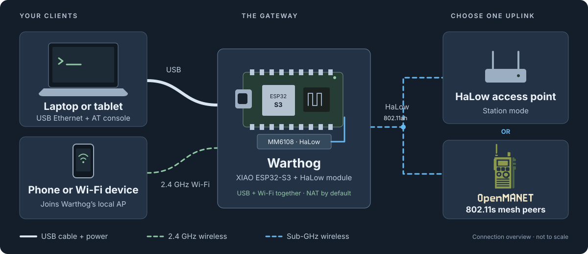
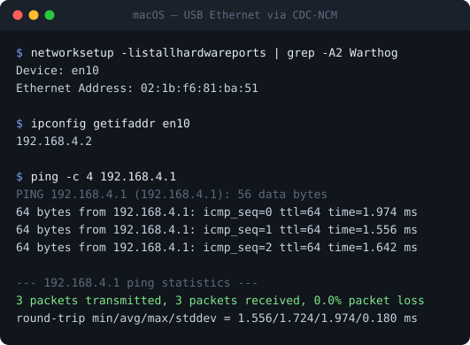

# Warthog

## USB + Wi-Fi clients → a long-range HaLow mesh

Turn a XIAO ESP32-S3 and a Wi-Fi HaLow module into a long-range gateway for
laptops, phones and tablets. A single USB cable carries Ethernet and a
configuration console; a 2.4 GHz Wi-Fi AP serves wireless clients at the same
time. The uplink joins a HaLow access point or an 802.11s mesh.



_About $30 in parts; prices are approximate and vary by supplier._

[Install firmware](https://thebentern.github.io/warthog/) ·
[Download releases](https://github.com/thebentern/warthog/releases) ·
[Read the guides](wiki/Home.md)

## Hardware

| Item | Part | Notes |
|---|---|---|
| Board | [Seeed Studio XIAO ESP32-S3](https://www.seeedstudio.com/XIAO-ESP32S3-p-5627.html) | USB Ethernet, console and 2.4 GHz Wi-Fi AP. |
| Radio | [Seeed Wi-Fi HaLow module for XIAO](https://www.seeedstudio.com/Wi-Fi-HaLow-Module-for-Seeed-Studio-XIAO-p-6262.html) | Quectel FGH100M-H / Morse Micro MM6108. |
| Antenna | 900 MHz antenna + I-PEX → SMA pigtail | Match the module's antenna connector. |
| Power modification | 470–1000 µF low-ESR capacitor, rated ≥16 V | Required across the XIAO's 5V and GND pads. |
| Cable | USB data cable | Powers the board and carries Ethernet and the console. |

### Before first power-up

**Fit the capacitor before using the radio.** The HaLow add-on feeds its power
amplifier from USB VBUS with only 20 µF of bulk capacitance. Radio startup can
collapse the supply and reset the ESP32-S3. Add the capacitor across **5V and
GND**, observing its polarity. See the [power notes](docs/power-notes.md).

The module supports **AU, JP, KR, NZ and US** channel plans within its
902–928 MHz band. Select the country you operate in before using the link;
an unconfigured board defaults to US. Country selection applies the channel,
power and duty-cycle limits. See [Regulatory](docs/firmware-reference.md#regulatory).

## Quick start

For a first setup with a **HaLow access point**, use the station image.
For mesh or OpenMANET, choose a build from [Operating modes](#operating-modes).

1. **Install the firmware.** Connect the board over USB. Hold **BOOT**, tap
   **RESET**, then release **BOOT** to enter download mode. Open the
   [web flasher](https://thebentern.github.io/warthog/) in desktop Chrome, Edge
   or Opera, select your country and install the station image. Tap **RESET**
   when it finishes.
2. **Open the console.** Use the flasher's **Configure** tab, or a serial
   terminal at **115200, 8-N-1**. The console appears as `/dev/cu.usbmodem*`
   on macOS or `/dev/ttyACM*` on Linux.
3. **Set your country and uplink.** Send the commands below, replacing `US`
   with your country and the credentials with those of your HaLow AP. Change
   the local Wi-Fi AP password too, then reboot.
4. **Connect a client.** The USB host receives an Ethernet adapter and a DHCP
   lease automatically. Wireless clients can join `warthog` with the password
   you set. Run `AT+STATUS?` to confirm the HaLow uplink has an IP address.

```text
AT+REGION=US
AT+HALOW=MyHaLowAP,my-uplink-password
AT+WIFIAP=warthog,my-new-ap-password,11
AT+RESET
```

The Wi-Fi AP ships with password `warthog-default`; replace it before deployment.
Settings persist across reboots. **Flashing a factory image erases stored
settings but keeps the region.** The flasher's **Erase & flash** also clears
the region and writes the one you select. See [Flashing](wiki/Flashing.md) for
updates that preserve settings and button-free reflashing with `AT+DLMODE`.



## Connections

| Client connection | Default network | Details |
|---|---|---|
| USB Ethernet | `192.168.4.1/24`; host leases start at `.2` | CDC-NCM, with in-box drivers on macOS, Linux, Windows 10+ and iOS/iPadOS. An ECM build is also available. |
| 2.4 GHz Wi-Fi AP | `192.168.5.1/24`; SSID `warthog` | Runs alongside USB; clients share the HaLow uplink. |
| USB serial console | Same USB cable | AT commands and ESP-IDF logs. No on-device web UI. |

USB and Wi-Fi clients are on separate subnets, routed through **NAT by default**.
Broadcast discovery such as mDNS and SSDP does not cross them. Multicast is not
forwarded except for the Meshtastic UDP repeater. Inbound connections to a
client need explicit forwarding. Experimental mesh bridge mode
(`AT+MESHBRIDGE=1`, mesh mode only) puts clients on the mesh's L2 segment instead.
See [NAT and bridge mode](docs/firmware-reference.md#nat-default-and-bridge-mode).

## Operating modes

Choose **one uplink**; USB Ethernet and the Wi-Fi AP remain available together.

| Uplink | Build to start with | Setup |
|---|---|---|
| HaLow access point | `warthog-station` | Set `AT+HALOW=SSID,password`, then reboot. |
| Warthog SAE mesh | `warthog-mesh-sae` | Match region, mesh ID, passphrase and channel on every peer. |
| OpenMANET SAE mesh without `bat0` | `warthog-mesh-sae-meshvif` | Match the node's mesh settings. |
| OpenMANET SAE mesh with `bat0` | `warthog-mesh-sae-swccmp-meshvif` | Match the node's mesh settings and set `AT+MESHBATMAN=1`. |

The station image can enable mesh with `AT+MESHEN=1`, but **SAE support is a
build-time choice**. Use an SAE build for link security. For open meshes,
ECM and diagnostic variants, see the [full build list](docs/firmware-reference.md#builds).

### Mesh and OpenMANET

A Warthog is a **mesh leaf by default**: it connects its own clients without
relaying traffic between other nodes. `AT+MESHFWD=1` enables experimental relay
mode. Bridge mode is also experimental.

OpenMANET's LuCI mesh wizard puts the radio in `bat0`; use the batman build
above for that configuration. A fresh OpenMANET image starts as an access
point, so configure its mesh first. Both sides must match country, channel,
bandwidth, mesh ID and security mode. Warthog has been tested with
**OpenMANET 1.8.0** on a Raspberry Pi 4 and Seeed HaLow HAT, using batman-adv
2025.4.

Follow [Mesh Mode](wiki/Mesh-Mode.md), [OpenMANET Gateway](wiki/OpenMANET-Gateway.md)
or [Batman Mode](wiki/Batman-Mode.md) for setup and verification. Detailed
compatibility limits are in [OpenMANET Interop](wiki/OpenMANET-Interop.md).

## Configuration and troubleshooting

Configure the board over USB without rebuilding. Common commands:

| Command | Purpose |
|---|---|
| `AT+VERSION?` | Firmware version. |
| `AT+STATUS?` | Interface addresses, uplink state and client DNS. |
| `AT+REGION?` | Running, stored and supported countries. |
| `AT+DNS=8.8.8.8` | Store a DNS server for clients; reboot to apply. |
| `AT+MESHCFG?` | Applied mesh settings and a peering diagnosis. |
| `AT+MPMPEERS?` | Mesh peers and handshake state. |
| `AT+RESET` | Reboot and apply stored settings. |

If the board repeatedly resets when the radio starts, check the
[power modification](docs/power-notes.md). If clients can reach an IP address
but cannot resolve names, check the DNS reported by `AT+STATUS?`. If a mesh
will not join, start with `AT+MESHCFG?`.

See the [AT command reference](wiki/AT-Command-Reference.md) and
[Troubleshooting](wiki/Troubleshooting.md) for the full command set and diagnostics.

## Security

**Use an SAE build and replace the default mesh passphrase** (`warthog-mesh`)
with `AT+MESHPASS=your-passphrase`, then reboot. Non-SAE builds use either
cleartext or a public constant key; they do not provide link security.

SAE protects individual hops. Every relay can read and inject traffic crossing
it, and the shared passphrase provides no per-node identity or revocation.
Use end-to-end protection such as WireGuard or Reticulum for sensitive traffic.
Update all Warthogs in an SAE mesh together. See the
[security reference](docs/firmware-reference.md#security) for key handling,
management frame protection and other limits.

## Development

Built with **ESP-IDF 5.5**, **TinyUSB** and **morsemicro/halow**, using PlatformIO.
To build the station image from source:

```bash
git clone https://github.com/thebentern/warthog.git
cd warthog
pip install platformio==6.2.0
export UV_CONSTRAINT="$PWD/scripts/ci/penv-constraints.txt"
pio run -e warthog-station
```

Keep `UV_CONSTRAINT` set in your build shell; the pinned pioarduino platform
requires it. The checkout path must not contain spaces. Enter download mode
as above, then run `pio run -e warthog-station -t upload` and tap **RESET**.

See [Quick Start](wiki/Quick-Start.md) for toolchain details and
[Development](wiki/Development.md) for repository layout, all build variants
and host tests.

## Reference

- [Host Mode](wiki/Host-Mode.md): USB compatibility, addressing and DNS.
- [Client Mode](wiki/Client-Mode.md): Wi-Fi AP credentials and configuration.
- [Mesh Mode](wiki/Mesh-Mode.md): Peer setup, addressing, bridging and forwarding.
- [OpenMANET Gateway](wiki/OpenMANET-Gateway.md): Connect phones and EUDs to a mesh.
- [Firmware reference](docs/firmware-reference.md): All builds, release files,
  build-time defaults, protocol behavior, security and licensing details.
- [Technical notes](docs/): Power delivery, NAT and mesh implementation findings.

## License

Warthog is licensed under **GPLv3**; see [LICENSE](LICENSE). Per-file licenses
apply to vendored SDK sources and other marked files. Morse Micro firmware and
board-configuration blobs use the **Binary Distribution Licence**, are
redistributed unmodified, and are only for Morse Micro hardware. See the
[licensing details](docs/firmware-reference.md#licensing) for component licenses
and blob redistribution requirements.
